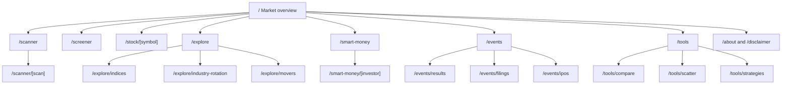

# 03. Information architecture

## Sitemap



## Navigation

**Top bar** (always visible):

| Position | Item |
|---|---|
| Left | Tathya wordmark (home) |
| Centre | Search box |
| Right | Markets menu, Research menu, data-freshness badge, theme toggle |

**Markets menu:** Market overview, Indices, Industry rotation, Movers, Results, Filings, IPOs.

**Research menu:** Scanner, Screener, Compare, Scatter, Strategies, Smart money.

**Filter bar** (below the top bar on market-wide pages): market-cap chips with counts, sector filter, share link. Filter state lives in the URL so any view is linkable.

## URL conventions

- Symbols are upper-case NSE symbols where one exists: `/stock/RELIANCE`. BSE-only companies use the BSE code.
- Filters are query parameters: `?cap=small&sector=pharma&period=1M`.
- Screener formulas are URL-encoded in `?q=` so screens can be bookmarked.

## Screens

Wireframes are schematic. Visual treatment is defined in the [design system](04-design-system.md).

### Home: market overview

```
+--------------------------------------------------------------------------------+
| Tathya        [ Search stocks...                 ]   Markets  Research  (o)    |
+--------------------------------------------------------------------------------+
| All 2,107 | Large 122 | Mid 161 | Small 550 | Micro 1,274     Filters   Share  |
+--------------------------------------------------------------------------------+
| Market overview                                   1D  1W  1M  3M  1Y           |
| +-----------+ +-----------+ +-----------+ +-----------+ +-----------+ +------+ |
| | Nifty 50  | | Sensex    | | Bank      | | Midcap    | | Smallcap  | | VIX  | |
| | level  %  | | level  %  | | level  %  | | level  %  | | level  %  | |      | |
| | ~~~~~~~   | | ~~~~~~~   | | ~~~~~~~   | | ~~~~~~~   | | ~~~~~~~   | |      | |
| +-----------+ +-----------+ +-----------+ +-----------+ +-----------+ +------+ |
|                                                                                |
| Sector indices                     | Market breadth                            |
| Energy    +0.0%  ====              | [ 285 up | 21 flat | 520 down ]           |
| FMCG      -0.0%  ===               | A/D 0.55   52W H/L 4/1                    |
| IT        -0.7%  ==                | Above 50-DMA 55%   Above 200-DMA 55%      |
|                                                                                |
| Industry rotation (tap to filter)                                              |
| [Diversified +1.1%] [Telecom +0.4%] [Consumer -0.1%] [Mfg -0.2%] ...           |
+--------------------------------------------------------------------------------+
| Scanner: firing today                                    Open scanner ->       |
| [RSI crosses 50 +92] [Supertrend up +70] [Range breakout +66] ...              |
| +---------------------------+ +---------------------------+ +----------------+ |
| | EPS accelerators (325)    | | Margin expanders (238)    | | Red flags (79) | |
| | company  price  metric    | | company  price  metric    | | ...            | |
| +---------------------------+ +---------------------------+ +----------------+ |
+--------------------------------------------------------------------------------+
| Movers  [Gainers v]                 | Results and filings today                |
+--------------------------------------------------------------------------------+
| Not investment advice. Prices as of 12 Nov 2026 (end of day).                  |
+--------------------------------------------------------------------------------+
```

### Stock page

```
+--------------------------------------------------------------------------------+
| RELIANCE  Reliance Industries Ltd        Energy > Refineries      [Compare]    |
| Rs 1,234.50  -0.6%   MCap 16.7L Cr   P/E 24.1   ROCE 9.8%   D/E 0.4            |
+--------------------------------------------------------------------------------+
| Overview | Chart | Financials | Ratios | Shareholding | Filings | Research     |
+--------------------------------------------------------------------------------+
| +----------------------------------------------+ +---------------------------+ |
| |  Price chart (candles, volume, 50/200 DMA)   | | Tathya Score   72  B+     | |
| |                                              | | Q  G  Gov  V  M  (bars)   | |
| |                                              | +---------------------------+ |
| |                                              | | In 6 scans today          | |
| |                                              | | - Strong uptrend (3d)     | |
| +----------------------------------------------+ | - Margin expanders (12d)  | |
|                                                  +---------------------------+ |
| Quarterly results                               Peers                          |
| metric | Q2 FY27 | Q1 FY27 | Q2 FY26 | YoY       company | MCap | P/E | ROCE   |
+--------------------------------------------------------------------------------+
| [ Ask Tathya about RELIANCE: results, concalls, margins, red flags...    Ask ] |
+--------------------------------------------------------------------------------+
```

### Scanner

```
+--------------------------------------------------------------------------------+
| Scanner                         112 scans   17 categories   Last run: 12 Nov   |
+--------------------------------------------------------------------------------+
| Categories        | Scan: Volume shockers                         [Combine +]  |
| > Popular         | Volume at least 3x the 20-session average, price up        |
|   Technical       | Members 7   New today 5   Exited 3     [history chart]     |
|   Chart signals   +------------------------------------------------------------+
|   Growth          | Members | New entries | Exits                              |
|   Quality         | company        price    1D     volume x    entered         |
|   Value           | ...                                                        |
|   Smart money     |                                                            |
|   Red flags       |                                                            |
+--------------------------------------------------------------------------------+
```

### Screener

```
+--------------------------------------------------------------------------------+
| Screener                                           [Filters] [Formula]         |
| +----------------------------------------------------------------------------+ |
| | ROCE > 20 AND PEG < 1 AND MarketCap > 5000                          [Run]  | |
| +----------------------------------------------------------------------------+ |
| Quick screens: [Debt-free compounders] [Fast growers, fair price] [...]        |
+--------------------------------------------------------------------------------+
| 84 results                               [Columns] [Save screen] [Export CSV]  |
| company | MCap | Price | P/E | PEG | ROCE | Sales gr 3Y | Score                |
+--------------------------------------------------------------------------------+
```

## Responsive behaviour

| Width | Layout |
|---|---|
| 1280 px and above | Full grid, multi-column tables |
| 768 to 1279 px | Two-column grid, side panels stack below |
| Below 768 px | Single column, tables scroll horizontally with the company column pinned, menus collapse to a drawer |

## States every screen must handle

- **Loading:** skeleton rows, never a blank page.
- **Empty:** a sentence saying why (for example "No stocks passed this scan on 12 Nov") and a next step.
- **Stale data:** a visible badge when the last successful pipeline run is older than the last trading day.
- **Error:** what failed and a retry, without losing filter state.
