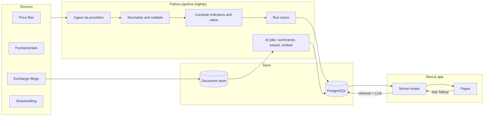

# 05. Architecture

Status: **proposed**. Confirmed when Phase 1 starts.

## Overview

Tathya is a read-heavy application over data that changes once a day. That shapes everything: do the heavy computation in nightly batch jobs, store the results, and keep the web app thin and fast.



## Tech stack

| Layer | Choice | Why |
|---|---|---|
| Web framework | Next.js (App Router), TypeScript | Server rendering for fast table-heavy pages, one codebase for UI and API |
| Styling | Tailwind CSS | Design tokens map directly to config |
| UI primitives | Radix-based headless components | Accessible menus, popovers and dialogs without a visual opinion |
| Tables | TanStack Table | Sorting, pinning and virtualisation for long lists |
| Price charts | Lightweight Charts | Purpose-built for candles |
| Other charts | A general-purpose React chart library | Bars, scatter, sparklines |
| Database | PostgreSQL | Relational fit, strong aggregates, `pgvector` for embeddings |
| Data access (web) | Typed query layer (Drizzle or Kysely) | Compile-time safety for SQL |
| Pipeline | Python, pandas, SQLAlchemy | Best ecosystem for market-data wrangling and indicators |
| Scheduling | Cron locally, GitHub Actions or a small worker later | One nightly run is enough |
| AI | One service module wrapping the LLM provider | Swappable, with caching and cost tracking in one place |
| Local dev | Docker Compose for Postgres | One command to start |

## Repository layout (planned)

```
tathya/
  README.md
  TODO.md
  docs/                    Design documents (this folder)
  apps/
    web/                   Next.js application
      app/                 Routes
      components/          UI components
      lib/                 Query layer, formula parser, formatting
  pipeline/                Python package
    tathya_pipeline/
      providers/           One module per data source, behind a common interface
      ingest/              Load raw data into staging
      compute/             Indicators, ratios, scores
      scans/               One file per scan definition
      ai/                  Summaries, extraction, embeddings
      cli.py               Entry points: ingest, compute, scan, all
    tests/
  db/
    migrations/            SQL migrations
    seed/                  Reference data (industries, indices, cap buckets)
  docker-compose.yml
```

## Nightly pipeline

Runs after the market closes and end-of-day files are available.

| Step | What happens | Fails safe by |
|---|---|---|
| 1. Ingest | Each provider fetches its data into staging tables | Skipping a provider that errors; the run continues |
| 2. Validate | Row counts, null checks, price sanity (no 10x jumps without a corporate action) | Quarantining bad rows |
| 3. Load | Upsert into core tables | Idempotent on (company, date) |
| 4. Adjust | Apply splits and bonuses to price history | Recomputing only affected companies |
| 5. Compute | Technical indicators, ratios, market cap, group aggregates | |
| 6. Scan | Evaluate every scan, write memberships, diff against the previous session | |
| 7. Publish | Write a `pipeline_run` record with status and "as of" date | The web app keeps showing the last good run |

Every step is re-runnable for a given date.

## Scan engine

- A scan is a Python object: id, name, category, stance (bullish, bearish, neutral, red flag), plain-language description, required fields, and a function from a universe DataFrame to a boolean mask.
- The engine builds one wide DataFrame for the day (plus the lookback each scan declares), evaluates all scans, and writes `scan_result` rows.
- Entries and exits are computed by set difference with the previous session.
- The description stored with the scan is what the UI shows, so the rule on screen is always the rule that ran.

## Screener formula language

- Grammar: identifiers (field names), numbers, `+ - * /`, comparisons, `AND OR NOT`, parentheses.
- Parsed to an AST in TypeScript, validated against the field registry, compiled to a parameterised SQL `WHERE` clause over a denormalised `screener_snapshot` table.
- The field registry is one source of truth for name, label, unit, group and SQL column, shared with the pipeline through a generated JSON file.
- Unknown fields and syntax errors return the character position for inline display.

## AI layer

| Capability | Approach |
|---|---|
| Result and concall summaries | Batch job per document, stored as text with the source document id |
| Guidance extraction | Structured output (metric, direction, magnitude, quote, page), stored in tables |
| Filing classification | Small model, labels for type, event and priority |
| Ask Tathya | Retrieval over chunked documents for the one company, answer with citations, refusal when the context lacks the answer |

Guardrails: answers are grounded in retrieved text only, always cite, never produce buy or sell language, and are cached by (company, question hash, document version). Spend is logged per job.

## Performance approach

- Precompute. Pages read from snapshot tables, not from raw history.
- Cache server responses keyed by `pipeline_run.id`; the whole cache turns over once a day.
- Index on (company_id, date) everywhere. Partition `price_daily` by year if it grows large.
- Virtualise long tables on the client.

## Environments and secrets

- Local first. A hosted deployment is optional and comes later.
- Secrets live in `.env`, never in the repo. An `.env.example` documents each variable.

## Testing

| Area | Test type |
|---|---|
| Indicators and ratios | Unit tests against hand-computed fixtures |
| Scans | Fixture universe with known members per scan |
| Formula parser | Unit tests for valid, invalid and hostile input |
| Pipeline | A small end-to-end run on a fixed sample date |
| Web | Component tests for tables and formatting; a smoke test per route |
