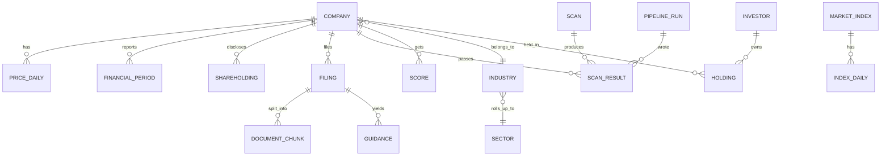

# 06. Data model

Status: **draft**. Column lists show the important fields, not every column.

## Entity overview

## Reference tables

### `company`

| Column | Type | Notes |
|---|---|---|
| `id` | bigint PK | |
| `isin` | text unique | Stable identifier across exchanges |
| `nse_symbol` | text | Nullable |
| `bse_code` | text | Nullable |
| `name` | text | |
| `industry_id` | FK | |
| `listing_date` | date | |
| `status` | text | active, suspended, delisted |

### `sector`, `industry`

Three levels: macro sector, sector, industry. `industry.sector_id`, `sector.macro_sector`.

### `market_index`, `index_constituent`

Index metadata and membership with `valid_from` and `valid_to` dates.

## Market data

### `price_daily`

| Column | Type | Notes |
|---|---|---|
| `company_id` | FK | PK with `date` |
| `date` | date | |
| `open`, `high`, `low`, `close` | numeric | As traded |
| `adj_close` | numeric | Adjusted for splits and bonuses |
| `volume` | bigint | |
| `value_traded` | numeric | |
| `delivery_pct` | numeric | Nullable |
| `source` | text | Provider id |

### `index_daily`

`index_id`, `date`, `open`, `high`, `low`, `close`.

### `corporate_action`

`company_id`, `ex_date`, `type` (split, bonus, dividend, rights), `ratio`, `amount`.

### `indicator_daily`

Precomputed technicals per company per day: moving averages (20, 50, 200), RSI 14, MACD and signal, ATR, supertrend state, 20-day average volume, 52-week high and low, all-time high.

## Fundamentals

### `financial_period`

| Column | Type | Notes |
|---|---|---|
| `company_id` | FK | PK with `period_end`, `period_type`, `basis` |
| `period_end` | date | |
| `period_type` | text | quarter, year |
| `basis` | text | consolidated, standalone |
| `revenue`, `operating_profit`, `pat`, `eps` | numeric | |
| `total_assets`, `equity`, `debt`, `cash` | numeric | Balance-sheet periods |
| `cfo`, `capex` | numeric | Cash-flow periods |
| `reported_on` | date | When the result was published |
| `source` | text | |

### `ratio_snapshot`

One row per company per day with valuation, profitability, growth and leverage ratios as of that date (P/E, P/B, PEG, ROE, ROCE, OPM, sales and profit growth over 1, 3 and 5 years, debt to equity, market cap).

### `screener_snapshot`

Denormalised latest row per company combining price, indicators, ratios, shareholding and scores. The screener and most list pages read only from this table. Rebuilt every night.

## Ownership

### `shareholding`

`company_id`, `quarter_end`, `promoter_pct`, `promoter_pledged_pct`, `fii_pct`, `mf_pct`, `insurance_pct`, `public_pct`.

### `investor`

`id`, `name`, `kind` (individual, family office, FII, mutual fund, insurer), `tracked` flag.

### `holding`

`investor_id`, `company_id`, `quarter_end`, `shares`, `pct`. Changes between quarters are derived.

## Events

### `filing`

| Column | Type | Notes |
|---|---|---|
| `id` | bigint PK | |
| `company_id` | FK | |
| `exchange` | text | |
| `filed_at` | timestamptz | |
| `title` | text | |
| `doc_type` | text | Classified: results, concall transcript, presentation, announcement, and so on |
| `event_flags` | text[] | Classified events: capex, fundraise, auditor change, and so on |
| `priority` | text | critical, high, normal, low |
| `source_url` | text | Link to the original |
| `storage_key` | text | Where the document is stored |

### `result_calendar`

`company_id`, `meeting_date`, `purpose`, `status`.

### `ipo`

`name`, `segment` (mainboard, SME), `open_date`, `close_date`, `listing_date`, `issue_size`, `price_low`, `price_high`, `issue_price`, `company_id` once listed.

## Scans

### `scan`

`id` (slug), `name`, `category`, `stance`, `description`, `version`, `active`.

### `scan_result`

| Column | Type | Notes |
|---|---|---|
| `scan_id` | FK | PK with `company_id`, `date` |
| `company_id` | FK | |
| `date` | date | |
| `is_new` | boolean | Entered on this date |
| `metrics` | jsonb | The values that made it pass, for display |
| `run_id` | FK | |

### `scan_daily_stat`

`scan_id`, `date`, `members`, `entries`, `exits`.

## Scores and AI output

### `score`

`company_id`, `date`, `quality`, `growth`, `governance`, `valuation`, `momentum`, `inputs` (jsonb).
The composite is computed at read time from the user's weights.

### `strategy_verdict`

`company_id`, `date`, `strategy` (cyclical, fast grower, turnaround), `score`, `verdict`, `inputs`.

### `document_chunk`

`filing_id`, `chunk_index`, `page`, `text`, `embedding` (vector).

### `summary`

`filing_id`, `kind`, `text`, `model`, `created_at`.

### `guidance`

`filing_id`, `company_id`, `metric`, `direction`, `magnitude`, `horizon`, `conviction`, `quote`, `page`, and later `outcome` once results are in.

## Operations

### `pipeline_run`

`id`, `as_of_date`, `started_at`, `finished_at`, `status`, `step_status` (jsonb), `notes`.

### `provider_fetch`

`provider`, `dataset`, `as_of_date`, `rows`, `status`, `error`. One row per provider call, for monitoring data quality.

## Conventions

- All money in rupees as `numeric`. Display conversion to lakh and crore happens in the UI.
- Dates are trading dates in IST. Timestamps are `timestamptz`.
- Every fact table records its `source`.
- Upserts are idempotent on the natural key.
